<div align="center">


# 🪦 SecondWind

### *Every unfinished project deserves a second look.*

**A graveyard for abandoned side projects, with a scoring engine that decides which ones deserve to live again.**

<br/>

[](https://project-graveyard-gold.vercel.app/)
[](https://drive.google.com/drive/folders/1eYu63fIn4m9T0o77mvZciTtYZnracijG?usp=sharing)


<br/>

**Code Variant · Build 01 · PS 05 — *The Project Graveyard***
**Team Binary Brains** — Sagnik Chandra · Shrusti Jain

</div>

---

## 📑 Table of Contents

| | | |
|---|---|---|
| 1. [💡 The Problem](#-the-problem) | 7. [🧮 Resurrection Score](#-the-resurrection-score) | 13. [🔐 Security & Privacy](#-security--privacy) |
| 2. [✨ The Solution](#-the-solution) | 8. [🗺️ Routes](#️-routes) | 14. [📁 Project Structure](#-project-structure) |
| 3. [🎬 Demo](#-demo) | 9. [🔄 Data Flow](#-data-flow) | 15. [🚀 Getting Started](#-getting-started) |
| 4. [🧰 Tech Stack](#-tech-stack) | 10. [🖐️ Canvas Protocol](#️-the-canvas-protocol-surprise-challenge) | 16. [🧪 Testing](#-testing) |
| 5. [🏗️ Architecture](#️-system-architecture) | 11. [🌌 Feature Map](#-feature-map) | 17. [☁️ Deployment](#️-deployment) |
| 6. [🧭 User Journey](#-user-journey) | 12. [⚡ Performance & A11y](#-performance--accessibility) | 18. [👥 Team](#-team) |

---

## 💡 The Problem

Most builders have a folder full of projects they started and never finished. They stopped because of scope creep, lack of time, or a shinier idea, and nobody wrote down why.

> Project trackers manage **active** work. Nothing helps you decide what to do with work you've already **dropped**.

The real gap is a decision: ***should this project live again, and in what form?***

## ✨ The Solution

SecondWind turns a pile of abandoned repos into a guided, visual decision.

<table>
<tr>
<td align="center" width="25%">🔬<br/><b>1. Autopsy</b><br/><sub>A 3-step wizard records what was built, what's left, and why it stopped.</sub></td>
<td align="center" width="25%">⚖️<br/><b>2. Verdict</b><br/><sub>A transparent score weighs six signals and recommends a path, with the reasons spelled out.</sub></td>
<td align="center" width="25%">🌱<br/><b>3. Second Wind</b><br/><sub>Each path does real work: a 7-day sprint, a pivot sketch, saved parts, a merge, or an epitaph.</sub></td>
<td align="center" width="25%">🧠<br/><b>4. Remember</b><br/><sub>A 3D garden, the Salvage Yard, the Death Report and reminders keep the graveyard useful over time.</sub></td>
</tr>
</table>

**Five possible verdicts:**

| 🌿 Revive | 🔀 Pivot | 🧰 Salvage | 🧵 Merge | 🕯️ Archive |
|:---:|:---:|:---:|:---:|:---:|
| Finish it with a focused 7-day sprint | Keep the core, change the direction | Harvest the reusable parts | Stitch it into a sibling project | Lay it to rest with an epitaph |

---

### How it works

<p align="center">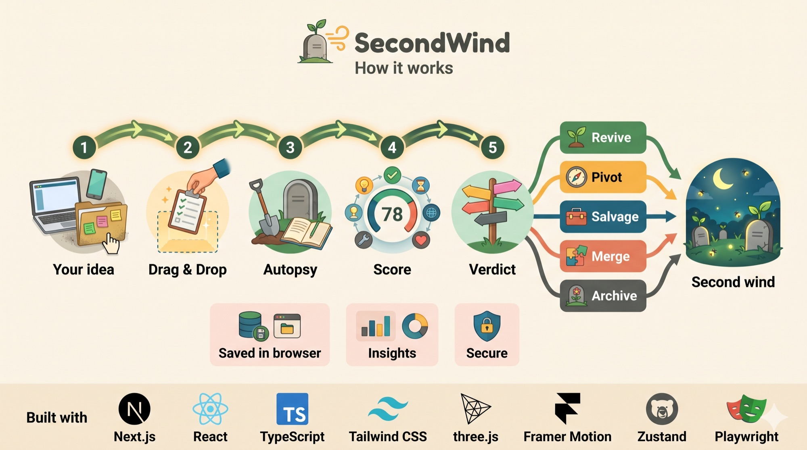</p>

## 🎬 Demo

<div align="center">

| 🌐 Live App | 🎥 Walkthrough Video |
|:---:|:---:|
| **[project-graveyard-gold.vercel.app](https://project-graveyard-gold.vercel.app/)** | **[Watch on Google Drive](https://drive.google.com/drive/folders/1eYu63fIn4m9T0o77mvZciTtYZnracijG?usp=sharing)** |

</div>

> 💡 Sample projects load automatically, so you can explore every feature right away. Try **Bury a project → Use sample** for a 30-second tour of the full flow.

---

## 🧰 Tech Stack

<div align="center">

<a href="https://skillicons.dev">
  
</a>

</div>

<br/>

| Layer | Technology | Why we chose it |
|---|---|---|
| ⚛️ **Framework** | Next.js 15 (App Router) · React 19 | Server components, file-based routing, built-in SEO and edge middleware |
| 🟦 **Language** | TypeScript 5 (strict) | Types shared end to end, from the scoring engine to the UI |
| 🎨 **Styling** | Tailwind CSS v4 · CSS custom properties | Design tokens, light/dark themes, no runtime CSS cost |
| 🌌 **3D** | three.js · React Three Fiber · drei | The interactive space garden and hero scene |
| 🎞️ **Motion** | Framer Motion | Jelly-physics drag, rituals, view-change spells, reveals |
| 🗃️ **State** | Zustand + `persist` | Small global store, saved to localStorage, no backend needed |
| 🧪 **Testing** | Playwright | End-to-end tests plus a 7-device smoke suite |
| ☁️ **Hosting** | Vercel | Edge network, preview deploys, security headers |

---

## 🏗️ System Architecture

<p align="center">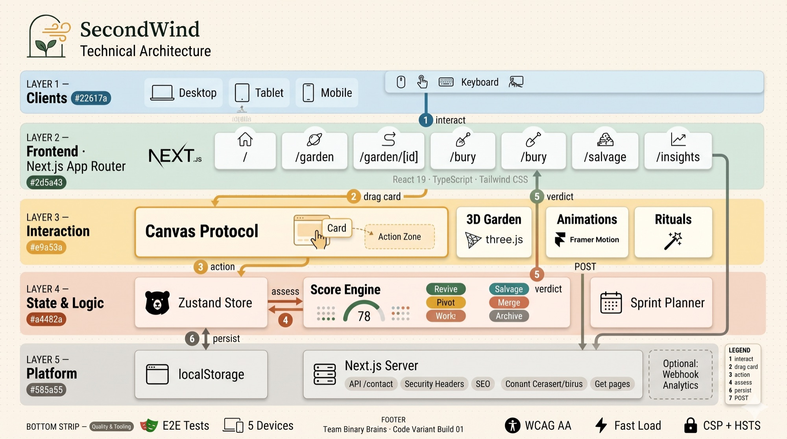</p>


<details>
<summary><b>View diagram</b></summary>

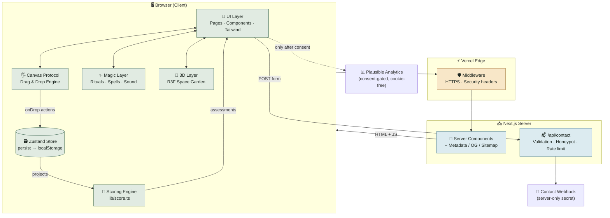

</details>

### Layered design

<details>
<summary><b>View diagram</b></summary>

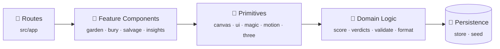

</details>

> **Design principle:** the domain layer (`src/lib`) is pure TypeScript with no React, so the scoring rules are easy to test and to argue with.

---

## 🧭 User Journey

<details>
<summary><b>View diagram</b></summary>

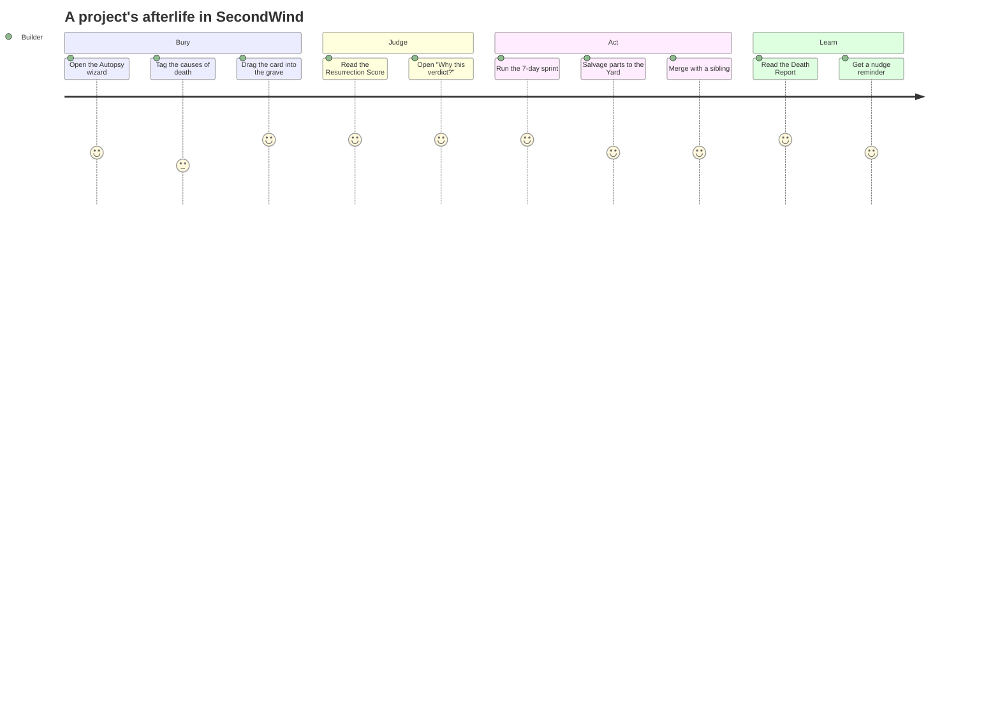

</details>

### Project lifecycle

<details>
<summary><b>View diagram</b></summary>

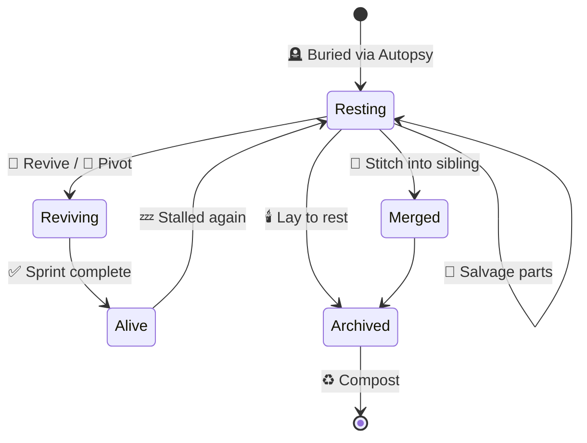

</details>

---

## 🧮 The Resurrection Score

`src/lib/score.ts` is **fully rule-based**, so you can trace every verdict back to its inputs. No black box.

<details>
<summary><b>View diagram</b></summary>

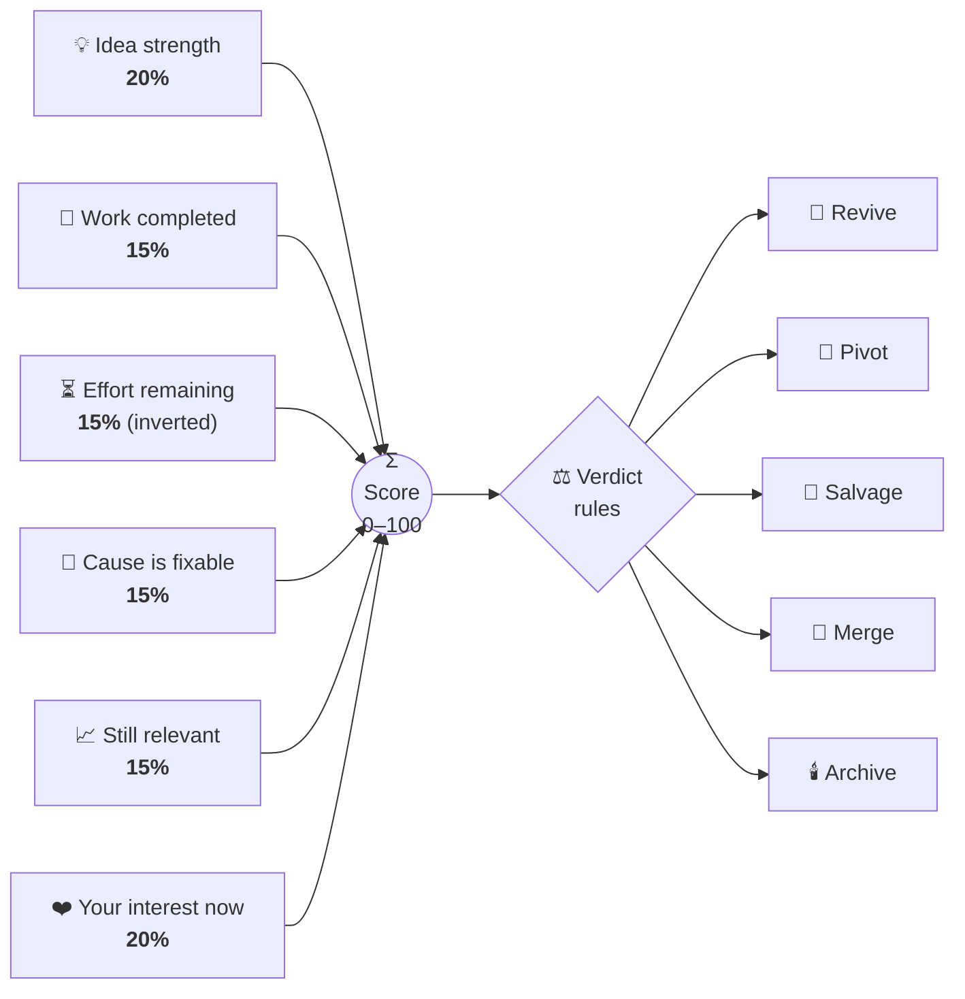

</details>

### Verdict decision tree

<details>
<summary><b>View diagram</b></summary>

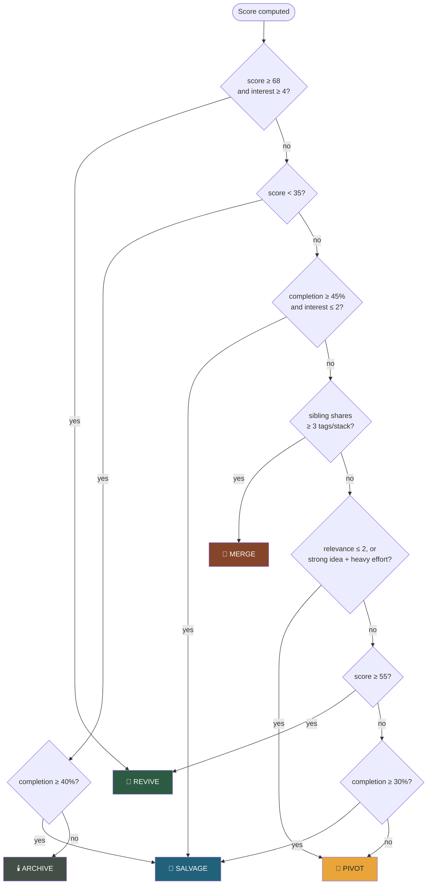

</details>

| Signal | Weight | Source |
|---|:---:|---|
| 💡 Idea strength | `0.20` | Autopsy slider (1–5) |
| 🧱 Work completed | `0.15` | Completion % |
| ⏳ Effort remaining | `0.15` | Inverted slider (1–5) |
| 🔧 Cause is fixable | `0.15` | Average fixability of the tagged causes of death |
| 📈 Still relevant | `0.15` | Autopsy slider (1–5) |
| ❤️ Your interest now | `0.20` | Autopsy slider (1–5) |

After the verdict, the engine generates a shrunk **7-day plan** from the "still unfinished" list.

---

## 🗺️ Routes

<details>
<summary><b>View diagram</b></summary>

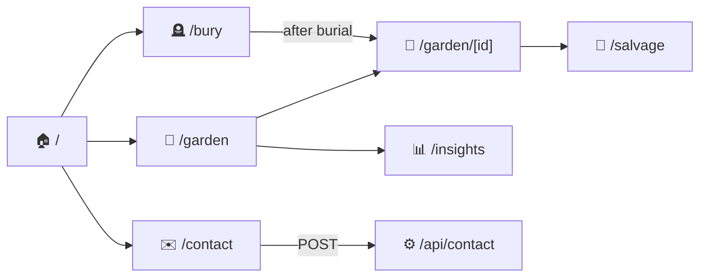

</details>

| Route | Purpose |
|---|---|
| `/` | Landing page with a live score demo and the journey |
| `/garden` | The garden in four views (Space · Plots · Ledger · Timeline) plus the action dock |
| `/garden/[id]` | Full verdict and path workspace |
| `/bury` (`?sample=1`) | The Autopsy wizard |
| `/salvage` | Salvage Yard: borrow parts into living projects |
| `/insights` | Death Report: patterns across all your projects |
| `/contact` · `/privacy` · `/terms` | Contact form and legal pages |
| `/api/contact` | Server-side validation, honeypot and rate limit |
| `/sitemap.xml` · `/robots.txt` · `/opengraph-image` · `/manifest.webmanifest` | SEO and app metadata |

---

## 🔄 Data Flow

### Burying a project

<details>
<summary><b>View diagram</b></summary>

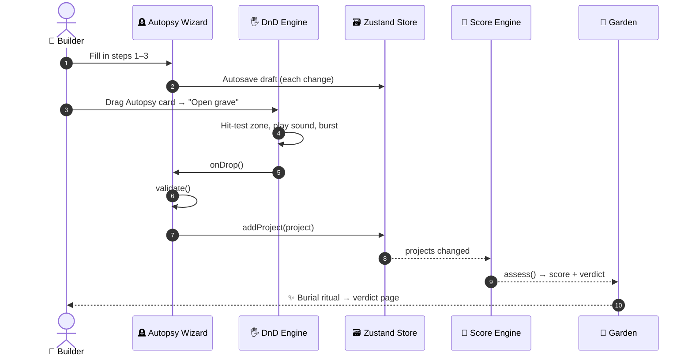

</details>

### Borrowing a salvaged part

<details>
<summary><b>View diagram</b></summary>

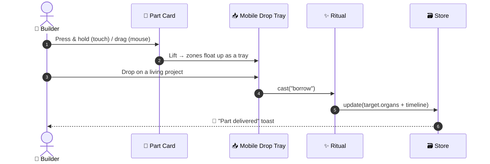

</details>

---

## 🖐️ The Canvas Protocol (Surprise Challenge)

> **Rule:** primary actions use **no standard buttons**. Every one is done by **dragging a data card into an Action Zone**.

<details>
<summary><b>View diagram</b></summary>

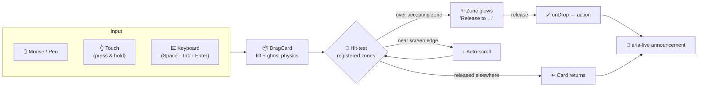

</details>

| Feature | 📦 Card | 🎯 Action Zones |
|---|---|---|
| Bury a project | Autopsy card | Next step → Open grave |
| Choose a path | Project headstone | Revive · Pivot · Salvage · Merge · Archive · Compost |
| 7-day sprint | Day cards | To do ⇄ Done |
| Save / pivot / archive | Part, pivot and epitaph cards | Salvage crate · Replant · Lay to rest |
| Merge | Sibling project | Stitching table |
| Reminders | Nudge card | 2 weeks · 1 month · 3 months · Clear |
| Garden dock | Any project card | Open verdict · Nudge · Compost |
| Borrow a part | Part card | Any living project |
| Contact | Letter | Mailbox |

**Highlights**
- 🫧 **Jelly physics:** the ghost card stretches along its direction of travel and gets "sipped" into hot zones.
- 👆 **Touch-friendly:** a swipe scrolls the page and press-and-hold lifts the card. On phones, drop zones float up as a bottom tray.
- ⌨️ **Keyboard:** Space picks up, Tab moves between zones, Enter drops, Escape cancels.
- 📢 **Screen readers** hear every step through an `aria-live` region.
- 🛑 **Destructive drops** (compost, reset) ask for a deliberate *slide-to-confirm* instead of a dialog.

---

## 🌌 Feature Map

<details>
<summary><b>View diagram</b></summary>

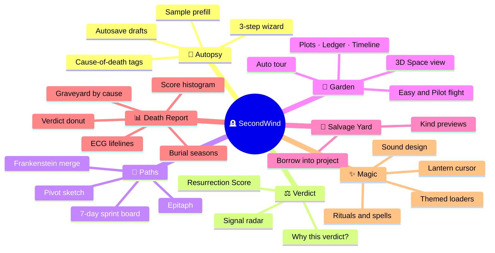

</details>

| Feature | Where |
|---|---|
| Guided Autopsy, cause-of-death tags, autosave, sample prefill | `/bury` |
| Resurrection Score, "Why this verdict?", signal radar | Garden side panel, `/garden/[id]` |
| Sprint plan, pivot sketch, salvage, Frankenstein merge, epitaph | `/garden/[id]` |
| 3D space garden (**Easy** mode by default, optional **Pilot** mode), Plots, Ledger, Timeline | `/garden` |
| Salvage Yard with kind-specific previews and Borrow | `/salvage` |
| Death Report: causes, verdict donut, ECG lifelines, histogram, seasons, stacks | `/insights` |
| Magic rituals, view-change spells, themed loaders, animated logo, lantern cursor | Site-wide |

---

## ⚡ Performance & Accessibility

<div align="center">

| ⏱️ First Paint | 🖼️ Largest Paint | 📐 Layout Shift | ♿ Contrast |
|:---:|:---:|:---:|:---:|
| **~0.35 s** | **< 1.2 s** | **~0** | **WCAG AA** |

<sub>Measured on a throttled mid-range phone profile.</sub>

</div>

<details>
<summary><b>View diagram</b></summary>

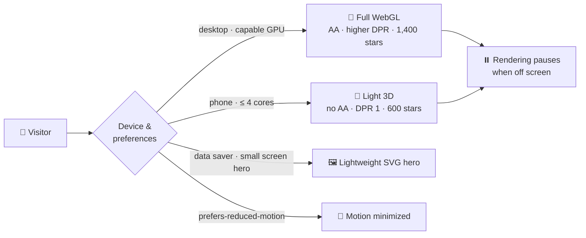

</details>

- 🚀 The cinematic intro plays **once per visit** and any tap or key skips it. Repeat loads fade in within 0.4 s.
- 📦 3D code is **lazy-loaded** (`next/dynamic`, `ssr: false`) and only fetched for the garden view.
- 🧘 `prefers-reduced-motion` is respected throughout.
- ♿ Skip link, ARIA labels, focus rings, full keyboard support and AA contrast in both themes.
- 📱 Responsive from 320 px up, with no sideways scrolling (checked by the device test suite).

---

## 🔐 Security & Privacy

<details>
<summary><b>View diagram</b></summary>

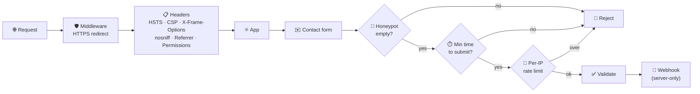

</details>

- 🔒 Strict security headers on every response.
- 🗝️ **No secrets in the frontend.** The contact webhook URL stays on the server.
- 🍪 Consent banner, and **no tracking cookies**. Analytics are cookie-free and only load after consent.
- 💾 Your projects never leave your browser. They're stored in `localStorage`.

---

## 📁 Project Structure

```bash
📦 secondwind
├── 📂 src
│   ├── 📂 app                 # 🗺️ Routes, layout, loaders, SEO files, API
│   │   ├── 📂 api/contact     #   📬 Server-validated contact endpoint
│   │   ├── 📂 bury            #   🪦 Autopsy wizard
│   │   ├── 📂 garden          #   🌌 Garden + [id] verdict workspace
│   │   ├── 📂 insights        #   📊 Death Report
│   │   └── 📂 salvage         #   🧰 Salvage Yard
│   ├── 📂 components
│   │   ├── 📂 canvas          # 🖐️ Drag & drop engine (Canvas Protocol)
│   │   ├── 📂 three           # 🌌 3D hero + space garden (R3F)
│   │   ├── 📂 magic           # ✨ Rituals, view spells, bursts
│   │   ├── 📂 garden          # 🌿 Garden app, views, switcher, panels
│   │   ├── 📂 project         # 📜 Verdict page and path panels
│   │   ├── 📂 insights        # 📊 Death Report charts
│   │   ├── 📂 salvage         # 🧰 Salvage Yard
│   │   └── 📂 bury · landing · layout · ui · motion · legal
│   ├── 📂 lib                 # 🧠 Pure domain logic
│   │   ├── 🧮 score.ts        #   Resurrection Score + verdict rules
│   │   ├── 🗃️ store.ts        #   Zustand store (persisted)
│   │   ├── 🌱 seed.ts         #   Sample graveyard
│   │   ├── ✅ validate.ts     #   Form validation
│   │   └── 🔊 sound.ts        #   Sound design
│   └── 🛡️ middleware.ts       # HTTPS + security headers
├── 📂 tests                   # 🧪 Playwright e2e + device suites
└── ⚙️ next.config.ts · playwright.config.ts · tsconfig.json
```

---

## 🚀 Getting Started

### Prerequisites


### Install & run

```bash
# 1️⃣ Clone
git clone <repo-url> secondwind && cd secondwind

# 2️⃣ Install dependencies
npm install

# 3️⃣ Start the dev server → http://localhost:3000
npm run dev

# 4️⃣ Production build
npm run build && npm start
```

> 🌱 Sample projects load automatically. Data lives in your browser, and **Replant** in the garden restores the sample set.

### 🔧 Environment variables

| Variable | Scope | Purpose |
|---|:---:|---|
| `NEXT_PUBLIC_SITE_URL` | 🌍 public | Canonical domain for metadata, sitemap and OG tags |
| `NEXT_PUBLIC_ANALYTICS_DOMAIN` | 🌍 public | Turns on cookie-free Plausible analytics, after consent |
| `CONTACT_WEBHOOK_URL` | 🔒 server | Where contact messages are delivered |

---

## 🧪 Testing

```bash
# Build into a separate folder so it never clashes with `next dev`
NEXT_DIST_DIR=.next-test npm run build
NEXT_DIST_DIR=.next-test npx next start -p 3100 &
BASE_URL=http://localhost:3100 npx playwright test
```

<details>
<summary><b>View diagram</b></summary>

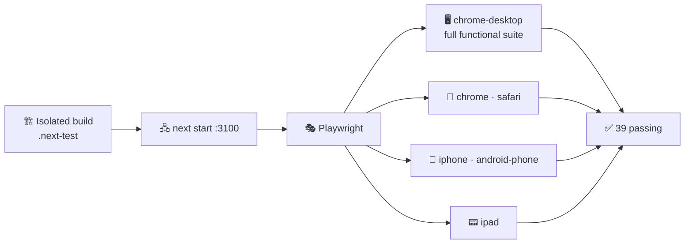

</details>

| Playwright project | Covers |
|---|---|
| 🖥️ `chrome-desktop` | Full functional suite: wizard, validation, bot traps, every drag-and-drop flow, keyboard dragging, SEO files, headers, a11y labels |
| 📱 `chrome` · `safari` · `ipad` · `iphone` · `android-phone` | Device smoke: every page renders, no sideways scrolling, fast boot, Easy/Pilot garden, real touch drag on Android |
| 🦊 `firefox` | Same smoke suite. Not verified in our environment, because Playwright's bundled Firefox wouldn't start on our macOS version. |

> **Last run: 39 tests passed** across 6 Playwright projects (Firefox not run).

---

## ☁️ Deployment

<details>
<summary><b>View diagram</b></summary>

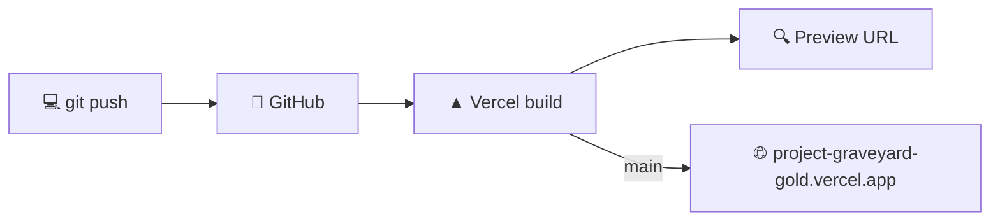

</details>

- [x] Deployed to Vercel → **[project-graveyard-gold.vercel.app](https://project-graveyard-gold.vercel.app/)**
- [ ] Set `NEXT_PUBLIC_SITE_URL` to the production domain
- [ ] Optionally set the analytics and webhook variables
- [ ] Check the site by hand in Firefox

---

## 👥 Team

<div align="center">

### Team **Binary Brains** 🧠⚡

|  |  |
|:---:|:---:|
| Developer | Developer |

<sub>Built for **Code Variant · Build 01 · PS 05 — The Project Graveyard**</sub>

<br/><br/>

**[🌐 Try it live](https://project-graveyard-gold.vercel.app/)** · **[🎬 Watch the demo](https://drive.google.com/drive/folders/1eYu63fIn4m9T0o77mvZciTtYZnracijG?usp=sharing)**

<br/>

<sub>🪦 Every project deserves a second look. 🌱</sub>

</div>
